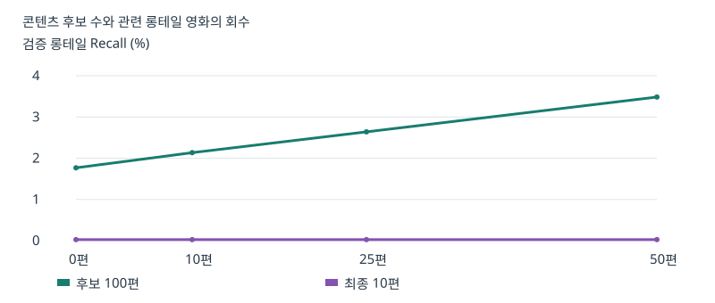
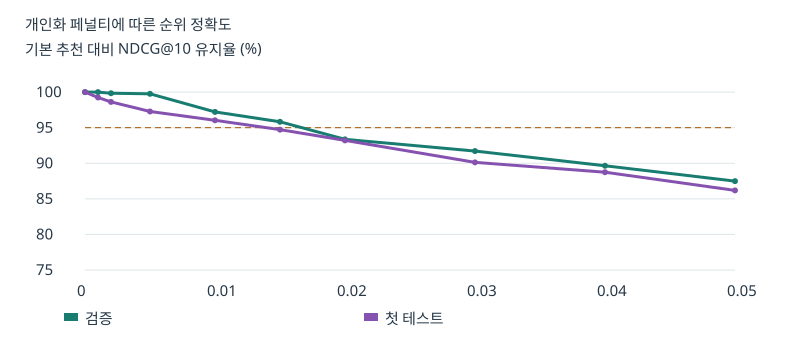

# Beyond Popularity · Team 2
바탕화면 프로젝트에서 시작.command를 더블 클릭하고 http://127.0.0.1:18765 를 엽니다. Python 3.9 이상(권장 3.11)이 필요하며 최초 실행은 가상환경과 의존성을 설치합니다. 최초 실행 전에 아래 명령으로 메타데이터를 추출하고 모델을 학습하세요. 영문 제목을 검색해 평점을 담고 추천 비교를 누르세요. ◆는 평점 수가 적은 영화입니다. 검증값에서는 세 목록이 같으므로 강도를 변경해 비교할 수 있습니다. UI는 FastAPI가 직접 제공하는 HTML/JavaScript입니다.

## 재현
공식 데이터 https://files.grouplens.org/datasets/movielens/ml-20m.zip 를 다운로드한 뒤 프로젝트 폴더에서 실행합니다. 데이터 사용 조건은 압축파일의 README를 따르세요.
```sh
python3.11 -m venv .venv
.venv/bin/pip install -r requirements.txt
.venv/bin/python prepare_metadata.py ~/Downloads/ml-20m.zip
.venv/bin/python model.py ~/Downloads/ml-20m.zip --users 2000 --epochs 10 --rank 24
```
전체 학습은 --users 0을 사용합니다. 평가까지 성공하면 artifacts/active가 새 runs 폴더의 실행 ID로 원자적으로 교체됩니다. 평가 후 서버를 재시작하세요.

## 실험 해석
사용자 단위 시드 42 무작위 표본에서 각 개인의 기록을 시간순 80/10/10으로 나눕니다. 동일 시각에는 영화 ID 순서를 사용합니다. 학습에서 관측한 영화만 후보·정답에 포함하고 테스트 시 검증 기간에 본 영화도 제외합니다. 시드 7로 최대 500명을 평가 대상으로 추출하며 각 기간에 4점 이상 적격 정답이 있는 사용자만 집계합니다. 이는 사용자별 분할이므로 달력상 동일한 시점의 예측 실험과 다릅니다.

편향항 포함 MF와 장르·Tag Genome 코사인 유사도를 결합합니다. Genome이 없는 영화는 장르만 사용합니다. 새 사용자에 대해서는 입력 평점으로 잠재요인과 편향을 추정합니다. 긍정 평점이 없으면 콘텐츠 점수와 인기 선호는 0.5입니다. 평점 수 상위 20%를 인기 영화로 정의하고 동률은 영화 ID로 결정합니다. 인기도는 log(1+평점 수)를 최댓값으로 나눕니다. 평점 수는 실제 노출 기록이 아닙니다.

검증 NDCG로 혼합 가중치를 선택한 뒤 기본 NDCG의 95% 이상을 유지하는 후보 중 롱테일 노출이 가장 높은 강도를 선택합니다. 개인화 강도는 선택한 최대 강도 × (1 − 긍정 기록 평균 인기도)입니다. 같은 하이브리드 상위 100편에서 재정렬합니다. validation.csv는 강도별 비교, test.csv는 선택된 설정의 전체·그룹별 지표입니다. coverage는 추천된 고유 영화 수 / 학습 영화 수입니다. tail과 popularity는 사용자별 상위 10편 평균을 다시 평균한 값입니다. 그룹 경계는 0.33과 0.66이며 평가 대상이 없는 그룹은 출력되지 않습니다.

출처: GroupLens MovieLens 20M, Harper & Konstan (2015), https://doi.org/10.1145/2827872

별을 한 번 누른 후 좌우로 이동하고 다시 누르면 별점·시청 완료가 함께 저장됩니다. 키보드는 Enter, 방향키, Enter 순서이며 Escape는 취소합니다.

cold_start.csv는 학습 밖의 사용자 최대 500명을 대상으로 합니다. 마지막 10% 기록의 카탈로그 내 긍정 영화를 정답으로 두고, 그 이전 최초 1·3·5개 적격 평점을 웹과 같은 fold-in 함수에 입력합니다. 롱테일 Recall@100·@10은 적격 롱테일 정답이 있는 사용자만 평균합니다. 전체 사용자 학습 시 독립 신규 사용자 표본은 0명입니다.

## 평가 및 검증 — 인기 편향을 줄이면서 추천 품질을 유지했는가?

**별도 평가 사용자 481명에서 개인화 페널티 0.005는 기본 NDCG@10의 96.46%를 유지했고, 롱테일 노출률은 14.39%에서 14.99%로 증가했다.** 95% 유지 목표는 표본 평균에서 충족했다. 유지율의 95% 신뢰구간은 91.96~100.55%로, 다른 사용자에서도 목표를 충족한다고 단정하기에는 불확실성이 남는다.

### 데이터와 판정 기준

MovieLens 20M의 사용자 2,000명을 추출한 개발 실험이다. 평점 270,178건 중 시간순 학습 기록은 215,343건이며 학습 카탈로그는 9,684편이다. 장르와 해당 배포본의 Tag Genome을 사용했고, 카탈로그 중 8,482편에 Genome 정보가 있다. MF의 잠재 차원은 24, 학습 횟수는 10 epoch다. 평점 수 상위 20%가 인기 그룹이고 나머지가 롱테일이다. 웹의 인기 TOP 10은 이보다 훨씬 작은 별도 목록이다. [학습 설정](outputs/training.json)

| 지표 | 집계 방법과 의미 |
|---|---|
| NDCG@10 | 보류 기간의 4점 이상 영화를 정답으로 두고 높은 순위의 적중에 더 큰 가중치를 준다. 기본 추천 대비 유지율은 두 방식의 사용자 평균 NDCG의 비다. |
| Recall@10 | 사용자별 적격 정답 중 추천 10편에 들어온 비율을 평균한다. |
| 롱테일 Recall@K | 사용자별 롱테일 정답 중 K편 안에 든 비율이다. 롱테일 정답이 있는 사용자만 평균한다. |
| 롱테일 노출률 | 상위 10개 자리 중 롱테일 비율이다. 모델이 생성한 목록을 대상으로 하며 실제 화면 노출 로그는 없다. |
| 평균 인기도 | 추천 영화의 학습 평점 수를 로그 변환·정규화한 값의 평균이다. 낮을수록 평가자가 적은 영화에 해당한다. |
| 카탈로그 커버리지 | 한 번이라도 추천된 고유 영화 수를 학습 카탈로그 크기로 나눈다. 표본 크기가 같은 비교에 사용한다. |

### 실험 1–2 · 추천 모델과 기본 순위의 집중도

첫 테스트의 적격 사용자 465명 중 225명에게 롱테일 정답이 있었다. 초기 실험은 각 방법의 점수로 후보를 만들고 같은 기준으로 Top 10을 평가했다. CF는 편향항 포함 행렬분해이고 콘텐츠 모델은 긍정 이력과의 코사인 유사도를 사용한다. 검증에서 선택된 하이브리드의 협업 가중치는 0.75다. [기본 모델 및 그룹별 원자료](outputs/test.csv)

| 모델 | NDCG@10 | Recall@10 | 롱테일 노출 | 커버리지 | 평균 인기도 |
|---|---:|---:|---:|---:|---:|
| 콘텐츠 | 0.01075 | 1.22% | 54.52% | 9.40% | 0.454 |
| CF | 0.01895 | 2.44% | 15.74% | 1.50% | 0.619 |
| 하이브리드 | **0.02576** | **2.85%** | 13.85% | 2.57% | 0.662 |

하이브리드는 정확도가 가장 높았지만, 전체 영화의 20%인 인기 그룹이 추천 자리의 86.15%를 차지했다. 초기 강도 탐색에서 검증 NDCG의 95% 유지 조건을 적용하면 고정·개인화 모두 0이 선택되어 세 방법의 테스트 결과가 같았다. [검증 탐색표](outputs/validation.csv)

### 후보 생성과 최종 점수의 영향 분리

후보 수를 100편으로 고정하고, 하이브리드 상위 후보를 먼저 채운 뒤 나머지 자리를 장르·Genome 유사도 순으로 채웠다. 사용자별 이미 본 영화와 중복을 제외했다. 검증에서 콘텐츠 후보 0·10·25·50편을 비교해 50편을 선택했다. [후보 수 비교표](outputs/candidate_comparison.csv)



| 첫 테스트 설정 | 롱테일 Recall@100 | 롱테일 Recall@10 | 전체 Recall@10 | NDCG@10 |
|---|---:|---:|---:|---:|
| 하이브리드 후보 100편 | 3.15% | 0.711% | 2.85% | 0.02576 |
| 하이브리드 50편 + 콘텐츠 50편 | **5.09%** | 0.711% | 2.85% | 0.02576 |
| 같은 혼합 후보, 최종 콘텐츠 가중치 65% | 5.09% | **0.826%** | 2.15% | 0.02102 |

기존 최종 콘텐츠 가중치 25%에서는 기존 상위 10편이 하이브리드 후보 50편 안에 그대로 포함된다. 최종 가중치를 별도로 검증한 65% 실험에서는 롱테일 적중이 늘었으나 테스트 NDCG가 18.4% 하락했다. [최종 가중치 검증·테스트 비교](outputs/ranking_weights.csv)

### 실험 3–4 · 동일한 후보에 고정·개인화 페널티 적용

이후 비교는 같은 사용자의 같은 혼합 후보 100편과 기본 점수를 공유한다. 고정 방식은 모든 사용자에게 같은 강도를 적용한다. 개인화 방식은 최대 강도에 (1 − 긍정 이력의 평균 인기도)를 곱한다. 아래 0.2는 페널티 효과를 관찰하기 위한 강한 설정이다. [전략별 집계](outputs/penalty_audit_summary.csv)

| 첫 테스트 전략 | NDCG@10 | 전체 Recall@10 | 롱테일 Recall@10 | 롱테일 노출 | 평균 인기도 |
|---|---:|---:|---:|---:|---:|
| 기본 | 0.02576 | 2.85% | 0.71% | 13.85% | 0.662 |
| 고정 0.2 | 0.00142 | 0.10% | 1.20% | 79.29% | 0.379 |
| 개인화 최대 0.2 | 0.01163 | 1.09% | 1.16% | 37.18% | 0.534 |

### 실험 5 · 강도 선택, 그룹 차이, 별도 표본 재검증

검증 NDCG 유지율이 95% 이상인 설정 중 롱테일 Recall, 이어서 노출을 우선하면 0.015가 선택됐다. 첫 테스트에서는 유지율 94.7%로 기준에 약간 못 미쳤다. 첫 테스트 결과까지 살핀 뒤 더 약한 **0.005**를 후속 가설로 정했다. 그래프의 점선은 95% 유지 기준이다. [강도별 수치](outputs/small_penalties.csv)



첫 테스트의 기본 하이브리드에서 주류 선호 그룹(361명)은 롱테일 노출 12.02%, NDCG 0.02396이었고 균형 그룹(104명)은 20.19%, 0.03201이었다. 탐색 성향 그룹은 적격 사용자가 0명이었다. 이 결과로 그룹별 개인화 효과의 우열을 판정하기 어렵다.

재검증에서는 앞선 500명을 제외한 사용자 중 시드 19로 500명을 새로 추출했다. **같은 학습 모델**을 사용하되, 강도는 결과를 보기 전 0.005로 고정했다. 전체 지표는 적격 사용자 481명, 롱테일 Recall은 213명에 대한 평균이다. [재검증 요약](outputs/independent_retest_summary.csv) · [평가 코드](retest.py)

| 별도 사용자 테스트 | 기본 | 개인화 최대 0.005 |
|---|---:|---:|
| NDCG@10 | 0.03068 | 0.02959 |
| 전체 Recall@10 | 3.03% | 2.92% |
| 롱테일 노출률 | 14.39% | **14.99%** |
| 롱테일 Recall@10 | 0.10% | **0.57%** |

유지율 신뢰구간은 동일 사용자의 두 결과를 짝지어 10,000회 복원추출해 계산했다. 관련 롱테일 영화의 발견은 늘었지만 전체 정확도는 소폭 하락했다. 전체 20M 규모 재현, 실제 서비스에서의 시청 만족도 검증은 후속 과제다.

### 신규 사용자 평가 및 재현 순서

훈련에 포함되지 않은 사용자의 초기 평점 1·3·5개로 웹과 같은 방식으로 사용자 잠재요인을 추정했다. 적격 사용자 472명에서 Recall@10은 각각 1.49%, 2.22%, 2.28%였다. 롱테일 정답이 있는 223명의 Recall@10은 각각 0.09%, 0.24%, 0.09%였다. 웹의 유사 사용자 추천 목록과 롱테일 자리 확보 규칙은 별도 기능이며 위 재정렬 성과에 포함되지 않는다. [신규 사용자 결과](outputs/cold_start.csv)

앞의 학습 명령은 기본 평가와 후보·신규 사용자 평가까지 실행한다. 이어서 저장소 루트에서 아래 명령으로 추가 비교를 재현한다. 사용자별 결과는 로컬 outputs 디렉터리에 기록한다.

```sh
.venv/bin/python ranking_experiment.py
.venv/bin/python verify_profile.py
.venv/bin/python small_penalties.py
.venv/bin/python retest.py
```

### 평균 강도를 맞춘 고정·개인화 재정렬 비교

같은 평균 페널티를 모든 사용자에게 주어도 비슷한 효과가 나는지 확인했다. 앞 절의 시드 19 재검증 표본을 다시 사용했다. 적격 사용자 481명 각각에 대해 학습 기록에서 개인화 강도 0.005 × (1 − 선호 인기도)를 구하고, 그 산술평균 약 0.001320을 고정 강도로 사용했다. 각 사용자 안에서는 세 방식이 후보 100편, 기본 점수, 동점 처리와 시청 제외 규칙을 공유한다. 이 비교는 이전 재검증과 같은 표본을 이용한 추가 분석이다.

| 방식 | NDCG@10 | 전체 Recall@10 | 롱테일 Recall@10 | 롱테일 노출률 |
|---|---:|---:|---:|---:|
| 기본 | 0.030679 | 3.025% | 0.099% | 14.387% |
| 동일 평균의 고정 페널티 | 0.029946 | 2.869% | 0.099% | 14.886% |
| 개인화 페널티 | 0.029594 | 2.919% | 0.569% | 14.990% |

| 개인화 − 고정 | 평균 차이 | 사용자 짝 부트스트랩 95% 구간 | 개선 / 하락 사용자 |
|---|---:|---:|---:|
| NDCG@10 | −0.000351 | [−0.001605, +0.000663] | 1 / 4 |
| 전체 Recall@10 | +0.050%p | [−0.057, +0.208]%p | 1 / 1 |
| 롱테일 Recall@10 | +0.469%p | [0.000, +1.408]%p | 1 / 0 |
| 롱테일 노출률 | +0.104%p | [+0.021, +0.208]%p | 5 / 0 |

차이의 구간은 사용자별 개인화·고정 차이를 10,000회 복원추출한 백분위 구간이다. 롱테일 Recall은 적격 정답이 있는 213명에 한정했다. 개인화로 롱테일 추천 자리가 5개 늘었지만, 관련 롱테일 영화 회수율 상승은 단 한 사용자에서 발생했다. 순위 정확도의 차이는 양방향 모두 가능한 범위다. 이 표본은 개인화의 소폭 노출 증가를 보여주며, 고정 방식 대비 발견·정확도의 일관된 우위를 입증하기에는 적중 변화가 드물다.

모델 학습 후 저장소 루트에서 `.venv/bin/python matched_penalty.py`로 재현한다. [실험 코드](matched_penalty.py) · [전략별 집계](outputs/matched_summary.csv) · [차이와 신뢰구간](outputs/matched_contrasts.csv)
